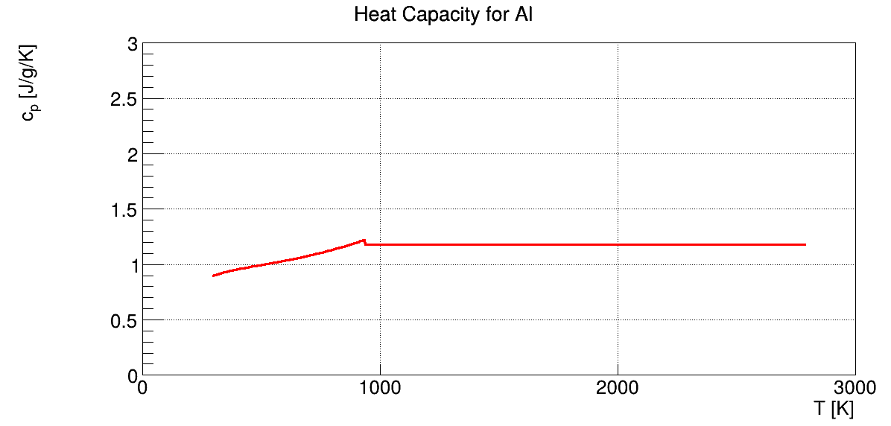
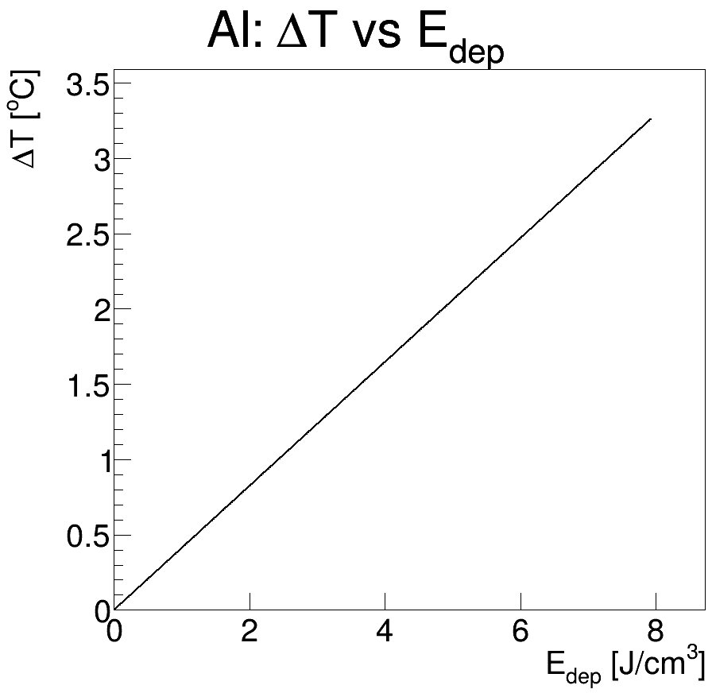
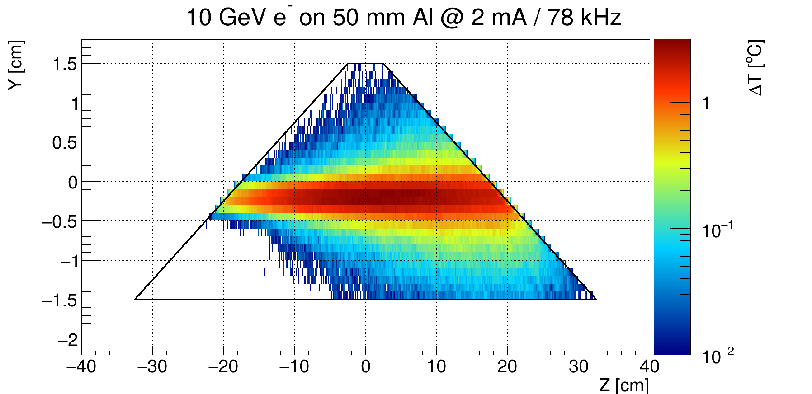
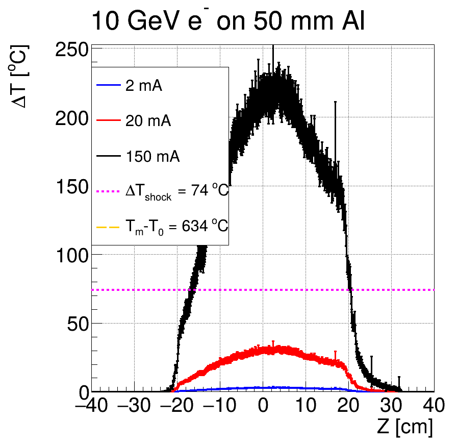
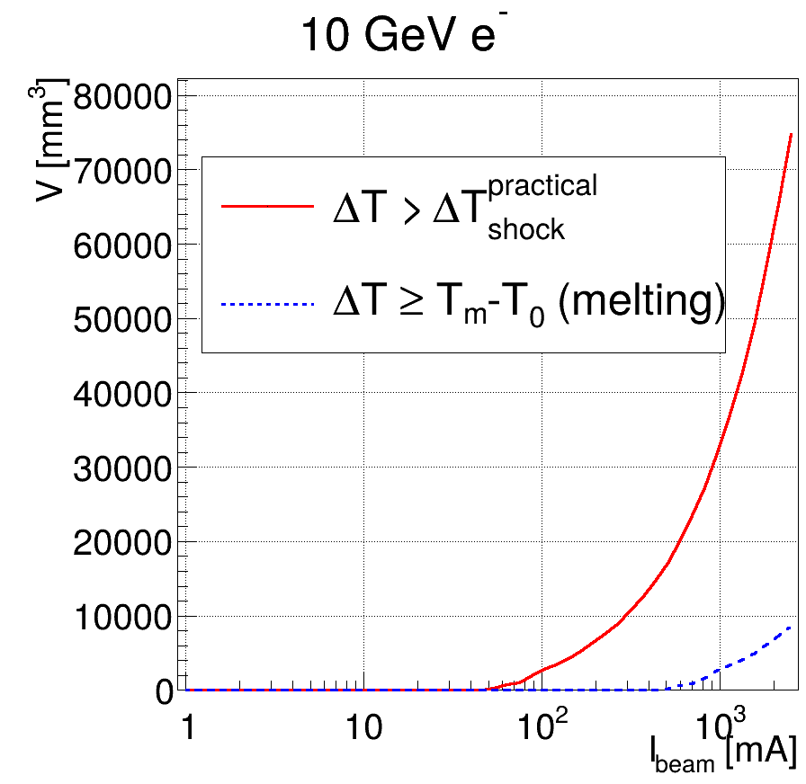
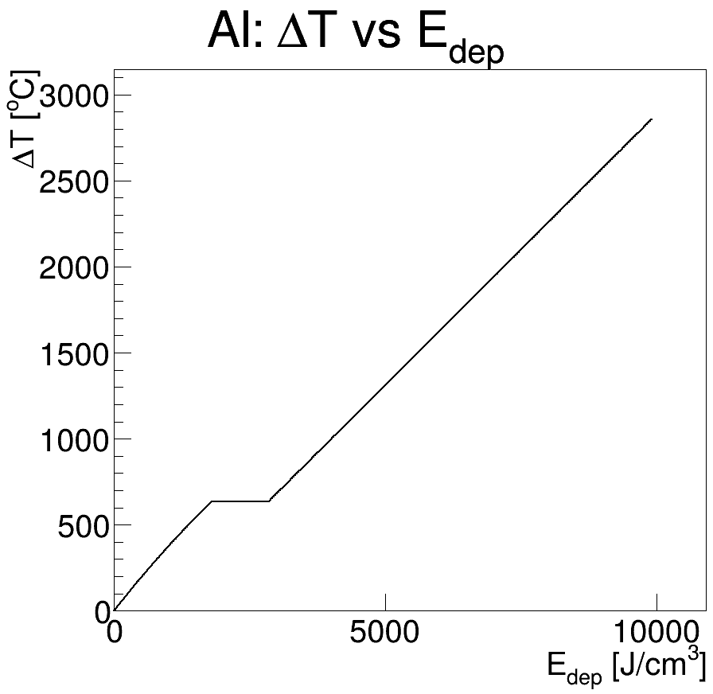

# Collimator Temperature-Rise

A minimal, self-contained **Geant4 + ROOT** example demonstrating the workflow used to evaluate the instantaneous temperature rise of an electron-beam collimator.

This repository is a reproducibility companion to the collimator robustness study. It deliberately uses:

- a simple tapered collimator geometry;
- pure aluminum (`G4_Al`);
- a Gaussian electron beam;
- illustrative beam parameters;
- a 3-D Geant4 energy-deposition scoring mesh; and
- ROOT macros that convert the deposited energy density into a temperature rise and estimate the volume affected by thermal shock or melting.

The example is **not** a model of the final EIC ESR collimator, and its numerical parameters should not be interpreted as EIC design parameters.

---

## Contents

1. [Quick start](#1-quick-start)
2. [Workflow](#2-workflow)
3. [Repository contents](#3-repository-contents)
4. [Requirements](#4-requirements)
5. [Build](#5-build)
6. [Run the Geant4 simulation](#6-run-the-geant4-simulation)
7. [Convert the scoring output to ROOT](#7-convert-the-scoring-output-to-root)
8. [Thermal analysis](#8-thermal-analysis)
9. [Thermal model](#9-thermal-model)
10. [Example results](#10-example-results)
11. [Simulation setup](#11-simulation-setup)
12. [Keeping the stages consistent](#12-keeping-the-stages-consistent)
13. [Adding a material](#13-adding-a-material)
14. [Scope and limitations](#14-scope-and-limitations)
15. [Troubleshooting](#15-troubleshooting)
16. [Relation to the robustness study](#16-relation-to-the-robustness-study)
17. [References](#17-references)
18. [Citation](#18-citation)
19. [License](#19-license)

---

## 1. Quick start

With Geant4 and ROOT set up in the shell (for example `source <geant4-install>/bin/geant4.sh` and `source <root-install>/bin/thisroot.sh`), run from the repository top directory:

```bash
# 1. Build
mkdir -p build && cd build
cmake ..
cmake --build . -j4

# 2. Simulate 1000 electrons (writes output.root and edep.csv; takes a few minutes)
./collimator_temp_rise run.mac Al 50 0.1 1 1 10 output.root 12345

# 3. Analyse (writes the plots to results/)
mkdir -p ../results && cd ../results
root -l -b -q '../ana/readScoring.C("../build/edep.csv","edep.root")'
root -l -b -q '../ana/drawScoring.C("edep.root","Al",50)'
```

The last argument of the simulation (`12345`) is the random seed; omit it to use a time-based seed. The example figures in [Section 10](#10-example-results) were produced with exactly these commands (plus `getCp.C` for the heat-capacity plot).

---

## 2. Workflow

The calculation is divided into two stages:

```text
                 GEANT4
                   │
                   ▼
        Electron transport through
        a simple tapered Al collimator
                   │
                   ▼
       3-D deposited-energy mesh
                   │
                   ▼
              edep.csv
                   │
                   ▼
             readScoring.C
                   │
                   ▼
             edep.root
                   │
                   ▼
             drawScoring.C
                   │
        ┌──────────┴──────────┐
        ▼                     ▼
  E_dep [J/cm³]          Thermal diffusion
        │                     │
        └──────────┬──────────┘
                   ▼
       ΔT(E_dep) using c_p(T)
                   │
        ┌──────────┴──────────────┐
        ▼                         ▼
   ΔT spatial maps          Beam-current scan
        │                         │
        ▼                         ▼
  maximum temperature      shock/melt volume
```

The separation is intentional: **Geant4 determines where and how much energy is deposited; the ROOT analysis converts that energy density into a thermal response.** The same Geant4 output can therefore be rescaled to any beam current without repeating the particle transport.

---

## 3. Repository contents

```text
.
├── CMakeLists.txt
├── LICENSE
├── README.md
├── main.cc                        Geant4 application and command-line interface
├── run.mac                        batch run: scoring mesh + 1000 electrons
├── vis.mac                        interactive geometry / trajectory check
├── include/  and  src/
│   ├── DetectorConstruction       vacuum world + tapered G4Trd collimator
│   ├── PrimaryGeneratorAction     Gaussian electron beam
│   └── RunAction                  run configuration and primaries -> ROOT file
└── ana/
    ├── ThermalModel.h             material data, c_p(T) and the ΔT(E_dep) solver
    ├── readScoring.C              edep.csv -> edep.root (THnSparse)
    ├── drawScoring.C              thermal analysis and plots
    ├── getCp.C                    plot of c_p(T)
    ├── getDeltaTempShock.C        elastic thermal-shock estimate
    ├── testThermalModel.C         self-test of the thermal model
    └── *.png                      example results shown in Section 10
```

Build products are intentionally **not** included: the repository contains no executable, CMake cache, object files, simulation output or machine-specific paths.

---

## 4. Requirements

- **Geant4** 11.x (tested with 11.3.2), built with Qt/OpenGL if the interactive `vis.mac` is used;
- **ROOT** 6 (tested with 6.40/04);
- a C++17-capable compiler;
- **CMake ≥ 3.16**.

Check the installations with:

```bash
geant4-config --version
root-config --version
cmake --version
```

The Geant4 data sets must be available (they are configured by `geant4.sh`).

---

## 5. Build

From the repository top directory:

```bash
mkdir -p build
cd build
cmake ..
cmake --build . -j4
```

This creates the executable `build/collimator_temp_rise` and copies `run.mac` and `vis.mac` into `build/`.

If CMake cannot find Geant4 or ROOT, point it to their CMake configuration directories, for example:

```bash
cmake -DGeant4_DIR=/path/to/geant4-install/lib/cmake/Geant4 \
      -DROOT_DIR=/path/to/root-install/cmake ..
```

---

## 6. Run the Geant4 simulation

### 6.1 Command line

```text
./collimator_temp_rise <macro> <material> <length_mm> <tan_theta> <sigma_x_mm> <sigma_y_mm> <beam_energy_GeV> <output.root> [seed]
```

| Argument | Meaning | Demonstration value |
|---|---|---:|
| `macro` | Geant4 macro; a file name containing `vis` starts an interactive session | `run.mac` |
| `material` | collimator material (only `Al` → `G4_Al` is implemented) | `Al` |
| `length_mm` | collimator tip length L1 [mm] (`0` builds no collimator) | `50` |
| `tan_theta` | tan(θ) of the collimator taper (> 0) | `0.1` |
| `sigma_x_mm` | Gaussian beam size σx [mm] | `1` |
| `sigma_y_mm` | Gaussian beam size σy [mm] | `1` |
| `beam_energy_GeV` | total electron energy [GeV] | `10` |
| `output.root` | ROOT file for the run configuration and primaries | `output.root` |
| `seed` | optional integer random seed (default: current time) | `12345` |

Invalid arguments (non-numeric values, `tan_theta ≤ 0`, unknown material, missing macro, ...) are rejected with an error message.

Run from the `build` directory:

```bash
./collimator_temp_rise run.mac Al 50 0.1 1 1 10 output.root 12345
```

The 1000-electron demonstration takes a few minutes on a single CPU core.

### 6.2 Output

| File | Content |
|---|---|
| `edep.csv` | 3-D energy-deposition scoring mesh (about 50 MB); input of the thermal analysis |
| `output.root` | tree `meta`: run configuration (`collMat`, `collLength` [mm], `collTanTh`, `beamSigmaX/Y` [mm], `beamEnergy` [GeV], `randomSeed`, `nEvents`) <br> tree `tree`: one entry per event (`eventID`, `beamGenPosX/Y/Z` [mm], `beamGenEkin` [GeV]) |

Both files are written to the working directory and are overwritten by a new run.

### 6.3 Beam current and statistics

The beam current is **not simulated directly** in Geant4. The simulation tracks individual electrons (1000 in `run.mac`), and the ROOT analysis scales the deposited energy to a beam current afterwards ([Section 9.4](#94-normalization-to-the-beam-current)).

Therefore, when `/run/beamOn` is changed, the same number must be passed to `drawScoring.C` as `nSim` ([Section 12](#12-keeping-the-stages-consistent)).

### 6.4 Reproducibility

The seed is printed at start-up and stored in `output.root` (`meta/randomSeed`). Re-running with the same seed reproduces `edep.csv` exactly with the same Geant4 installation and platform.

---

## 7. Convert the scoring output to ROOT

Create a results directory and convert the Geant4 CSV file:

```bash
mkdir -p ../results
cd ../results
root -l -b -q '../ana/readScoring.C("../build/edep.csv","edep.root")'
```

This creates `results/edep.root` containing the `THnSparseF` object `h1`, which stores the deposited energy per mesh cell [MeV] (summed over all simulated electrons) on the same spatial mesh as the Geant4 scoring mesh (axes x, y, z in cm). The per-cell sum of squared per-event deposits is stored as the bin error² and is used for the statistical uncertainties.

The full argument list is

```text
readScoring(csvFile, rootFile, boxSizeX, boxSizeY, boxSizeZ, nBinX, nBinY, nBinZ, translateX, translateY, translateZ)
```

with **full** box lengths and the mesh center in cm. The defaults (`4, 4, 80, 40, 40, 800, 0, -0.2, 0`) match `run.mac`. If the CSV file does not match the mesh arguments, the macro stops with an error instead of producing a mis-binned histogram.

---

## 8. Thermal analysis

From the `results` directory:

```bash
root -l -b -q '../ana/drawScoring.C("edep.root","Al",50)'
```

The full argument list is

```text
drawScoring(edepFile, material, length_mm, nSim, tan_theta, beam_energy_GeV, sigma_x_mm, sigma_y_mm)
```

| Argument | Used for | Default |
|---|---|---:|
| `edepFile` | output of `readScoring.C` | `"edep.root"` |
| `material` | thermal model (only `"Al"`) | `"Al"` |
| `length_mm` | collimator outline and plot titles | `50` |
| `nSim` | normalization; **must equal `/run/beamOn`** | `1000` |
| `tan_theta` | collimator outline | `0.1` |
| `beam_energy_GeV` | plot titles | `10` |
| `sigma_x_mm`, `sigma_y_mm` | thermal-diffusion factor | `1`, `1` |

Use the same values as on the `collimator_temp_rise` command line, e.g. for 10000 electrons:

```bash
root -l -b -q '../ana/drawScoring.C("edep.root","Al",50,10000)'
```

The beam currents (`Ibeam`, `Ibeam1`, `Ibeam2`), the revolution frequency (`revFreq`) and the range of the current scan are set in the **USER SETTINGS** block at the top of `drawScoring()`.

The macro takes a few seconds and writes:

| File | Content |
|---|---|
| `cYZ_Al.png` | ΔT map in the Y–Z plane (average of the two central X cells, −1 mm < x < 1 mm) at `Ibeam` |
| `c3_Al.png` | maximum ΔT in each Z slice for `Ibeam`, `Ibeam1` and `Ibeam2` |
| `c4_Al.png` | ΔT(E_dep) curve used for the maps |
| `c5_Al.png` | thermal-shock volume and melt volume (melting started) versus beam current |
| `c6_Al.png` | ΔT(E_dep) curve over the full range of the current scan |
| `grShockVolume_Al.root`, `grMeltVolume_Al.root` | the two curves of `c5_Al.png` as `TGraph` |

The console output summarizes the key numbers, e.g. the maximum ΔT for each current with its statistical uncertainty and the energy-density thresholds.

### Further macros

From the `results` directory (like all macros, they also work from any other directory when given the correct path):

```bash
root -l -b -q '../ana/getCp.C'               # plot c_p(T) -> c1_heat_capacity.png
root -l -b -q '../ana/getDeltaTempShock.C'   # elastic thermal-shock estimate
root -l -b -q '../ana/testThermalModel.C'    # self-test of the thermal model
```

---

## 9. Thermal model

The material data and the ΔT(E_dep) conversion are implemented once, in `ana/ThermalModel.h`, and shared by all macros.

### 9.1 Temperature-dependent heat capacity

For aluminum, the analysis uses the NIST Shomate parameterization of the heat capacity, with separate parameters for the solid and the liquid phase.

The aluminum parameters used in the demonstration are:

```text
T0      = 300 K           initial temperature
ρ       = 2.70 g/cm³
Tm      = 934 K           melting temperature (also the solid/liquid switch of c_p)
Lf      = 1045 J/cm³      latent heat of fusion per unit volume
k       = 210 W/m/K       thermal conductivity (thermal diffusion only)
```

### 9.2 Deposited energy → temperature rise

Each mesh cell is treated as adiabatic. Its deposited energy density is converted into a temperature rise by integrating

```text
dE = ρ c_p(T) dT
```

from `T0`:

1. the solid is heated up to `Tm`;
2. the next `Lf` is absorbed at constant temperature (a partially molten cell has ΔT = Tm − T0);
3. the liquid is heated above `Tm` with the liquid heat capacity.

The integration uses energy steps of at most 0.1 J/cm³ (≈ 0.04 K); the last step absorbs exactly the remaining energy. `testThermalModel.C` verifies the result against the closed-form integral of the NIST parameterization (agreement better than 0.01 K up to ΔT = 2400 K).

The resulting relation is approximately linear at low energy density, flattens on the melting plateau and rises again in the liquid phase (see `c6_Al.png`). For aluminum, ΔT_shock = 74 K is reached at E_dep ≈ 184 J/cm³, melting starts at ≈ 1797 J/cm³ and the material is completely molten above ≈ 2842 J/cm³.

### 9.3 Thermal-shock criterion

The demonstration uses a practical instantaneous temperature-rise threshold

```text
ΔT_shock = 74 K
```

(`Al.dT_shock` in `ana/ThermalModel.h`). For reference, `getDeltaTempShock.C` evaluates the elastic estimate

```text
ΔT = σ_UTS (1 − ν) / (E α)
```

with Al-1100 properties (σ_UTS = 90 MPa, ν = 0.33, E = 68 GPa, α = 24 µm/m/K), which gives ≈ 37 K. The adopted practical threshold is twice this value: the plasticity factor of 2 that the accompanying paper applies to ductile metals (Al, Cu, Ti and Ta alloys) as an empirical engineering correction, checked against APS-U beam-abort data. It is not a universal failure criterion.

This criterion is intended as a **robustness threshold**, not as a complete thermo-mechanical failure model.

### 9.4 Normalization to the beam current

The scorer provides the energy deposited by `nSim` simulated electrons. The analysis normalizes it to the number of electrons delivered in one revolution period at beam current `I` — equivalently, the whole stored beam lost in a single turn:

```text
N_e = I / (e f_rev)

E_dep [J/cm³] = E_MC [MeV/cm³] / nSim × N_e × (1 MeV in J)
              = E_MC [MeV/cm³] × 10⁶ × I / (f_rev × nSim)
```

For `I = 2 mA` and `f_rev = 78 kHz`, `N_e ≈ 1.6 × 10¹¹` electrons.

### 9.5 Thermal diffusion

The analysis includes the transverse thermal-diffusion scaling used in the original study. The characteristic diffusion length is

```text
σ_diff = sqrt(α_th t),     α_th = k / (ρ c_p(T0)),     t = 1 / f_rev,
```

and the peak energy density of a Gaussian beam is reduced by

```text
σx σy / sqrt((σx² + σ_diff²)(σy² + σ_diff²)),
```

a factor that is applied uniformly to all mesh cells. For the demonstration (σx = σy = 1 mm, f_rev = 78 kHz) σ_diff ≈ 33 µm and the factor is 0.999, i.e. the correction is negligible.

**This is an analysis assumption and should be clearly stated whenever the method is used quantitatively.**

### 9.6 Threshold volumes

For each beam current of the logarithmic scan, the analysis computes

- the **thermal-shock volume**: all cells with ΔT > ΔT_shock (E_dep > 184 J/cm³ for aluminum), and
- the **melt volume**: all cells in which melting has started, i.e. cells that reached Tm and are partially or completely molten (ΔT ≥ Tm − T0, E_dep > 1797 J/cm³ for aluminum).

Because ΔT(E_dep) is monotonic, both conditions are evaluated exactly as energy-density thresholds (no interpolation). The console output also gives the threshold for complete melting (2842 J/cm³).

### 9.7 Statistical uncertainties

Geant4 writes for every cell the sum of the per-event deposits, S1, and the sum of their squares, S2. For `N = nSim` primaries the variance of S1 is estimated as

```text
Var(S1) = N / (N − 1) × (S2 − S1² / N)
```

The uncertainty of the hottest cell in each Z slice is shown as error bars in `c3_Al.png`. With 1000 electrons the hottest 1-mm³ cells have a relative statistical uncertainty of about 15 %; increase `/run/beamOn` for quantitative results.

---

## 10. Example results

The figures below were produced with the commands of the [Quick start](#1-quick-start) (seed 12345):

```text
E_e = 10 GeV,  σx = σy = 1 mm,  L1 = 50 mm,  tan(θ) = 0.1,  1000 electrons,  f_rev = 78 kHz
```

### Heat capacity

The temperature-dependent aluminum heat capacity used by the calculation (`getCp.C`):



The heat capacity is evaluated continuously in the temperature-rise calculation rather than assuming a constant `c_p`. The step at 934 K is the solid–liquid transition.

### Deposited energy → temperature rise

The relation between deposited energy density and instantaneous temperature rise over the range needed for the 2 mA map:



`drawScoring.C` uses this curve to convert every non-empty mesh cell from deposited energy density into temperature rise.

### Two-dimensional temperature distribution

The resulting temperature-rise distribution in the longitudinal/transverse plane at `I_beam = 2 mA`:



The black outline indicates the simplified tapered collimator geometry. Cells with ΔT < 0.01 K are not shown.

### Maximum temperature rise along the collimator

The maximum temperature rise in each longitudinal slice for several illustrative beam currents:



The error bars are the statistical uncertainties of the hottest cell in each slice. The horizontal reference lines indicate:

- the practical thermal-shock threshold;
- the temperature interval from the initial temperature to the aluminum melting point.

The figure demonstrates why the same Geant4 energy-deposition calculation can be rescaled to different beam currents without repeating the particle transport, provided the underlying assumptions remain valid.

### Volume exceeding robustness thresholds

The volume in which the temperature rise exceeds the thermal-shock threshold, and the volume in which melting has started, as a function of beam current (logarithmic current grid):



The thermal-shock volume is generally the more relevant quantity for assessing the onset of mechanical damage before melting occurs.

### Extended deposited-energy range

The `ΔT(E_dep)` curve over the range of the beam-current scan:



The curve shows the solid heating, the melting plateau and the liquid heating. Temperatures above the boiling point of aluminum (≈ 2.8 × 10³ K) are outside the validity of the model.

---

## 11. Simulation setup

### 11.1 Geometry

The world is a 4 × 4 × 4 m³ vacuum box (`G4_Galactic`). The demonstration collimator is a single `G4Trd` jaw centered at the origin:

```text
L1 = user-specified tip length
H  = 30 mm          full height (y)
W  = 30 mm          full width (x)
L2 = L1 + 2 H / tan(theta)     base length (650 mm for the demonstration)
```

The solid is rotated by 90° about X so that its taper lies along the beam direction (z): the tip (L1) is at y = +15 mm and the base (L2) at y = −15 mm. A beam at y = −2 mm traverses 390 mm of aluminum (≈ 4.4 radiation lengths). The interactive check of [Section 11.5](#115-interactive-geometry-check) shows the geometry.

This geometry is intentionally generic. For an actual ESR study, the simple solid can be replaced by the detailed collimator geometry while retaining the scoring and thermal-analysis workflow. The jaw must stay clear of the primary vertex at z = −1 m (L2 < 2 m); the program stops with an error otherwise.

### 11.2 Beam

Each event contains one electron, generated at z = −1 m with transverse position

```text
x ~ N(0, σx)
y ~ N(−2 mm, σy)
```

and travelling in the `+z` direction. The energy given on the command line is the total energy; the electron rest mass is subtracted to obtain the kinetic energy. The demonstration models a simplified transverse Gaussian beam rather than the full machine phase-space distribution.

### 11.3 Physics and material

The reference physics list `FTFP_BERT_EMZ` (most accurate standard electromagnetic option) is used. The collimator material is `Al → G4_Al`. The original development version contained definitions for several additional materials; they have intentionally been removed to keep the example focused and easy to reproduce.

### 11.4 Scoring mesh

`run.mac` defines a box scoring mesh of the deposited energy:

```text
/score/mesh/boxSize 2 2 40 cm          HALF-lengths -> 4 cm × 4 cm × 80 cm
/score/mesh/nBin 40 40 800             -> 1 mm × 1 mm × 1 mm cells
/score/mesh/translate/xyz 0. -0.2 0. cm   centered at the mean beam position
```

Note that `/score/mesh/boxSize` takes **half-lengths**. The mesh covers the whole collimator along z.

The cell size (1 mm) is equal to the beam size, and the beam axis lies on cell boundaries. The scored energy density is therefore an average over the cells; use finer cells (and more electrons) when the peak energy density matters quantitatively.

### 11.5 Interactive geometry check

The geometry and electron trajectories can be viewed interactively:

```bash
cd build
./collimator_temp_rise vis.mac Al 50 0.1 1 1 10 output.root
```

Because the macro name contains `vis`, the program opens an interactive session (OpenGL viewer in a Qt window) after executing `vis.mac`. This is useful for checking the orientation of the collimator, the beam position, the taper and the particle trajectories. It is not required for the numerical thermal analysis.

---

## 12. Keeping the stages consistent

Several quantities must remain synchronized when adapting this example:

| Geant4 side | Analysis side |
|---|---|
| `/run/beamOn N` in `run.mac` | `nSim = N` argument of `drawScoring.C` (also stored as `meta/nEvents` in `output.root`) |
| mesh definition in `run.mac` | mesh arguments of `readScoring.C` (full lengths = 2 × `boxSize`) |
| command-line `length_mm`, `tan_theta`, `beam_energy_GeV`, `sigma_x_mm`, `sigma_y_mm` | corresponding arguments of `drawScoring.C` |
| collimator height H = 30 mm (`DetectorConstruction.cc`) | `collH` in `drawScoring.C` (outline only) |
| — | beam currents `Ibeam`, `Ibeam1`, `Ibeam2` and revolution frequency `revFreq` in `drawScoring.C` |

The beam currents and the revolution frequency are pure analysis parameters; they are not parameters of the Geant4 event generator and must be adapted when the method is applied to a different machine or beam configuration.

The number of simulated electrons and the random seed are printed at the end of the Geant4 run and stored in `output.root`; they can be checked with:

```text
root -l output.root
root [1] meta->Scan("nEvents:randomSeed")
```

---

## 13. Adding a material

The thermal analysis currently supports only aluminum (`Al` and `cp_al(T)` in `ana/ThermalModel.h`). A new material needs:

1. density;
2. melting temperature;
3. latent heat of fusion;
4. thermal-shock criterion;
5. thermal conductivity; and
6. temperature-dependent heat capacity.

Add a `MaterialProps` instance and its `c_p(T)` function to `ana/ThermalModel.h` and register the name in `getMaterialModel()`. On the Geant4 side, add the material to `DetectorConstruction::GetMaterial()` and to the material check in `main.cc`.

---

## 14. Scope and limitations

### Included

- Geant4 electron transport;
- electromagnetic shower development;
- 3-D energy-deposition scoring with statistical uncertainties;
- conversion to deposited-energy density;
- beam-current normalization;
- temperature-dependent aluminum heat capacity;
- melting transition;
- thermal-shock threshold;
- approximate transverse thermal diffusion;
- threshold-volume calculation.

### Not included

- detailed ESR collimator geometry;
- realistic machine lattice;
- time-dependent bunch structure;
- transient ANSYS thermo-mechanical response;
- elastic/plastic deformation;
- stress-wave propagation;
- detailed temperature-dependent thermal conductivity;
- temperature-dependent mechanical properties;
- vaporization;
- cooling and steady-state heat transfer;
- contact resistance or mechanical mounting;
- radiation damage/material degradation.

Consequently, the example should be viewed as a **demonstration of the methodology**, not as a replacement for the detailed thermo-mechanical analysis.

---

## 15. Troubleshooting

| Problem | Solution |
|---|---|
| CMake cannot find Geant4 or ROOT | Source `geant4.sh` and `thisroot.sh`, or pass `-DGeant4_DIR=...` / `-DROOT_DIR=...` ([Section 5](#5-build)). |
| Geant4 complains about missing data sets | Source `geant4.sh` of the Geant4 installation before running. |
| `readScoring.C`: "does not match the mesh arguments" | The mesh in `run.mac` was changed; pass the new mesh to `readScoring.C` (full lengths = 2 × `boxSize`). |
| Temperatures off by a constant factor | `nSim` in `drawScoring.C` does not match `/run/beamOn` ([Section 12](#12-keeping-the-stages-consistent)). |
| `drawScoring.C`: "has no per-cell variance" | `edep.root` was produced by an older `readScoring.C`; re-run `readScoring.C`. |
| `vis.mac` fails to open a viewer | Geant4 was built without Qt/OpenGL; change `/vis/open OGLIQt` in `vis.mac` to an available driver (see `/vis/list`). |

---

## 16. Relation to the robustness study

The intended use of this repository is to make the computational procedure underlying the temperature-rise estimates transparent and reproducible.

The key quantity passed from Geant4 to the thermal calculation is the local deposited-energy density:

```text
E_dep [J/cm³]
```

The robustness analysis then evaluates

```text
E_dep → ΔT
```

and compares the resulting temperature rise with material-dependent limits such as

```text
ΔT_shock
Tm - T0
```

This makes it possible to identify where the collimator is expected to remain below the thermal-shock limit and where localized damage may occur.

---

## 17. References

The material heat-capacity data are based on the NIST Chemistry WebBook:

- Aluminum, condensed-phase thermochemistry data:
  https://webbook.nist.gov/cgi/cbook.cgi?ID=C7429905&Units=SI&Mask=2

The thermal-diffusion scaling follows the reference retained in `drawScoring.C`:

- https://inspirehep.net/files/f5414415b1051da61d51f427adb336be

The mechanical properties used by `getDeltaTempShock.C` are referenced in the macro. The specific material and thermal-shock assumptions should be cited to the corresponding sources used in the accompanying paper.

---

## 18. Citation

If you use this package in scientific work, please cite the associated publication/preprint and the repository release URL.

```text
A. Natochii,
"Collimator Temperature-Rise Example,"
2026, https://github.com/eic/collimator-temperature-rise.
```

---

## 19. License

This software is distributed under the Brookhaven Science Associates open-source license; see [LICENSE](LICENSE).
